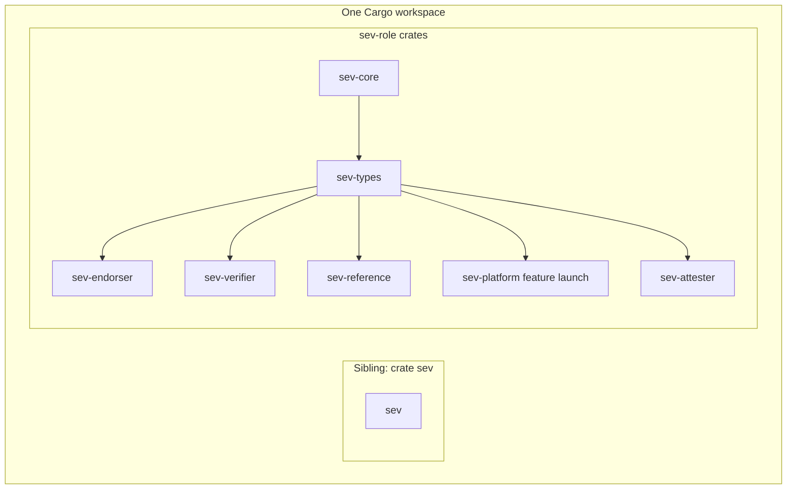

# Proposal: VirTEE SEV library Refactor

One Cargo workspace: sibling crate `sev` plus `sev-*` role crates (`sev` keeps consumer-blocking SNP updates while `sev-*` is built)

This is an architecture proposal for discussion **before** a workspace implementation PR. It is not a commitment to crate names, trait methods, or a release date.

## Codebase status (this repository)

This proposal is specified against **what we ship** on upstream `main`. That layout stays the public API of crate `sev`. **Venice** generation support is already released there. **ABI 1.59 attestation-report** fields are still being added, and landing them does not freeze `sev`. While `sev-*` is built, `sev` can still take SNP features that would block current consumers, on today's API. The RATS redesign and the report builder belong in `sev-*`.

The RATS refactor and new report-parsing branches are **not landing** on `sev` / `main`. They stay in git as a **map** of roles and module boundaries when we port SNP into `sev-*`. The report API to implement is the builder in this document, not `Report` then `ReportBody` from those branches. Closing those PRs means **do not merge them into the published crate**. It does not mean throw the branches away.


| Line               | Where it lives                                                                 | Crate `sev` 8.x layout                                                                                                                                                          | SNP attestation and crypto                                                                                                                                                                                                                                                                                                                                                   |
| ------------------ | ------------------------------------------------------------------------------ | ------------------------------------------------------------------------------------------------------------------------------------------------------------------------------- | ---------------------------------------------------------------------------------------------------------------------------------------------------------------------------------------------------------------------------------------------------------------------------------------------------------------------------------------------------------------------------- |
| **Shipped**        | [virtee/sev](https://github.com/virtee/sev) `main`                             | Top-level modules: `certs`, `firmware`, `launch`, `measurement`, `session`, `vmsa`, `parser`, `error`. Host and guest ioctls live under `firmware::host` and `firmware::guest`. | Report type: `firmware::guest::types::snp::AttestationReport`. Chains and verification: `certs::snp`. Crypto features: `openssl` and `crypto_nossl` (mutually exclusive; **not** in `default`).                                                                                                                                                                              |
| **Reference only** | `rats-refactor-pr` and the report-parsing work (**will not merge** into `sev`) | `types` (ABI vocabulary), internal `firmware`, public `platform` and `launch`, RATS module `attestation::{verifier, endorser, attester, reference}`.                            | Reports: `attestation::verifier::report::snp` (`Report`, `ReportBody`). Verification: `attestation::verifier`. Endorsement: `attestation::endorser`. Role features: `verifier`, `endorser`, `reference`, `attester` (`verifier` implies `endorser`). Crypto: `crypto-openssl` / `crypto-rust`. Default profile: SNP verifier stack without legacy `sev` or guest `attester`. |


On `main`, `default = ["sev", "snp", "openssl?/vendored"]`. Both generations compile. OpenSSL itself is **opt-in** (`openssl` or `crypto_nossl`); certificate and report verification stay off until one of those is enabled. The `openssl?/vendored` entry only turns on OpenSSL’s `vendored` feature **if** the `openssl` crate is already in the build.

On the reference `rats-refactor-pr` branch, defaults target remote SNP verifiers (`snp`, `verifier`, `endorser`, `reference`, `crypto-openssl`). First-generation SEV stays behind feature `sev`. That default mix is a guide for `sev-*`, not a planned `sev` 8.x release.

## Proposed Changes Summary

1. Add **one** Cargo **workspace**. Crate `sev` (no hyphen) is a **sibling member**. Separately versioned SNP role crates are named `sev-<role>` (`sev-core`, `sev-types`, `sev-verifier`, …). A thin `sev-core` crate holds traits and general concepts and should change rarely. Shared firmware ABI values live in `sev-types`. Each RATS or host role is its own crate, so downstream packages (and Fedora RPMs) can depend on the leaf they actually use.
2. Keep crates.io `sev` **self-contained** with `main`’s public API (`firmware`, `certs`, `launch`, and so on). It is in the same workspace but **not** in the `sev-*` dep graph: no `sev` ↔ `sev-*` dependencies and no re-exports. Do not land the RATS / report-parsing redesign there, and do not turn it into a feature-flagged mega-library. **Venice** is already released. **ABI 1.59 attestation-report** fields are still being added on today's types, and that work does not freeze `sev`. While `sev-*` is built, `sev` can still take SNP features that would block current consumers. Copy those fields, including 1.59, into `sev-*` so the new crates are not behind. Whether SNP APIs later **leave** crate `sev` is an open question.
3. Add `Certify` in `sev-core`. `sev-endorser` implements it for a `Certificate` enum whose `Openssl` and `RustCrypto` variants compile only when `openssl` or `crypto_nossl` is enabled. Those two features exist only on `sev-endorser`. `sev-verifier` calls the existing `verify` on `Report::Strict`, and that calls `Certify::verify_sig`. The verifier does not enable either crypto library. `Attestable` turns `Report::Verified` into an attestation-result token (for example EAR). Token contents stay out of this proposal.
4. Give `sev-verifier` a report builder. `parse_strict` returns `Report::Strict`, `verify` consumes that report and returns `Report::Verified`, and `parse_lax` returns `Report::Lax`. The three variants hold one private field struct. Lax reads known fields when reserved bytes are non-zero ([#343](https://github.com/virtee/sev/issues/343)). `to_attestation_result` succeeds only for `Report::Verified`. Lax is not a Cargo feature and not Rust `unsafe`. `Report` is verifier-only.


## Motivation


### Fedora packaging

Cargo **features** only change what compiles. Fedora still ships **one** `rust-sev` package. A bump of that package forces a rebuild of every reverse dependency, even when the change was in host ioctls and the consumer only verifies reports.

Independently versioned `rust-sev-verifier`, `rust-sev-platform`, … let a packager update one leaf without a mass rebuild, **as long as** `sev-core` **stays API-stable** and consumers depend on the leaf crate rather than a kitchen-sink package.

### Dependencies and compilation ([#369](https://github.com/virtee/sev/issues/369))

Trustee and similar remote verifiers need to **compile and verify SNP reports on aarch64 and s390x**. [#369](https://github.com/virtee/sev/issues/369) showed that a default `sev` build did not allow that:

1. **CPUID** — `arch::_cpuid` (and related generation switching) is x86-only but lived in the shared library path, so non-x86 targets failed to compile even when the consumer only wanted report verification.
2. `rdrand` — pulled in for first-generation SEV session/key material, it is not usable on those targets and was an extra reason a “just verify SNP” build broke.

We addressed those in the current crate by **skipping CPUID on non-x86** ([#329](https://github.com/virtee/sev/pull/329)) and by making `rdrand` a `sev`-feature dependency only ([#340](https://github.com/virtee/sev/pull/340)). That unblocks a carefully chosen feature set. It does not fix the design.

The leftover problem is **Cargo feature union** in a **single** crate: if any dependency enables `default` (or `sev`), the whole graph gets those features and the x86-only code can come back. More generally, **dependencies were driving which features you could actually use**, instead of the consumer picking a role and only then taking the crates that role needs.

This workspace inverts that: you depend on `sev-verifier` (or another leaf), and **that crate’s features pull the deps**. `sev-verifier` must not depend on `sev-platform`, crate `sev`, CPUID/RDRAND, or other host/guest-only code. Role features on one mega-crate are still one Fedora package and still unify; separate crates do not.

### First-generation SEV is support-only; SNP on `sev` stays current for blockers

Community direction: **no new feature work** on pre-SNP SEV (bugfix and security only). That API should **not** be redesigned into the new trait/workspace model. It stays in crate `sev` (`certs::sev`, `launch::sev`, `session`, and so on).

SNP that already lives in `sev` (`firmware` guest/host, `certs::snp`, `launch::snp`, `measurement`, `AttestationReport`) already includes **Venice**. **ABI 1.59** is still being added to today's `AttestationReport`, and finishing it does not freeze SNP on `sev`. While `sev-*` is built, `sev` can still take later SNP features when leaving them out would block current consumers. Those updates stay on today's types. The same fields are copied into `sev-*`. The report builder and the RATS redesign do not land on `sev`.

### Forward-compatible report parsing ([#343](https://github.com/virtee/sev/issues/343))

Remote verifiers receive reports from firmware they do not control. A newer report version (for example V5) fills bytes that an older crate treated as reserved-and-zero. On `main`, `AttestationReport` decode uses `skip_bytes`, which **requires those regions to be zero**, so an old client cannot even read `measurement` / `guest_policy` after a server firmware bump. That is intentional for the **verified** path (do not overstate security when fields are unknown), but it is unusable for distributed clients that must keep working until they update.

This proposal splits **strict** vs **lax** parse in `sev-verifier` through that builder (see below). It is **not** solved by `Attestable`. The lax **report** API lives only in `sev-verifier`. Byte-level skip helpers live in `sev-core` (always compiled; no feature). 1.59 on crate `sev` is a known-layout update of today’s `AttestationReport`, still in progress, not the report builder. Landing it does not freeze `sev`.

## Repository Organization

One git repository, **one** Cargo `[workspace]`. Members are crate `sev` **and** the `sev-*` crates. `sev` is a **sibling**: same workspace, **not** in the SNP dependency graph.

A typical layout is the current root package remaining `sev`, with `[workspace]` `members = [".", "sev-core", "sev-types", …]`. A virtual workspace that lists `sev` as a member is also fine. `default-members` may control what a bare `cargo check` builds at the repository root. It does **not** affect `cargo check --workspace`, which selects every member. Cross-target CI must name the portable crates (or `--exclude` the x86-only ones).

Crate `sev` (no hyphen) is the published legacy library. Hyphenated `sev-<role>` crates are the new SNP architecture. `sev` must not re-export `sev-verifier` (or any other leaf); that would make Fedora `rust-sev` depend on every SNP leaf again.

First-generation **SEV is being deprecated as a product**: no new features, support-only. Downstream still has working `use sev::…` code (`certs::sev`, `launch::sev`, `session`, and the current SNP APIs mixed into the same crate). This proposal keeps crate `sev` so those consumers can take bugfixes, security fixes, and SNP features that would block them, without a forced migration onto `sev-*`.

**Venice** is already released on crate `sev`. **ABI 1.59** is still being added on today’s `AttestationReport` and generation switching, not the report builder, and finishing it does not freeze the crate. While `sev-*` is built, later SNP features that would block current consumers can still land there the same way. Each one, including 1.59, is copied into `sev-*`, so the new crates are not behind. Two copies during that overlap are intentional. Whether crate `sev` **keeps** its existing SNP modules (`firmware` SNP, `certs::snp`, `launch::snp`, `measurement`) after consumers can switch, or **drops** them in a later major, is an open question.

Landing a RATS redesign or the report builder on `sev` would churn every consumer of the published crate (Fedora reverse deps included) for an API we would then replace with `sev-*`. Blocker features stay on today's API. They do not bring that redesign with them.

The suggested balance:

- `sev` — today’s public API, including SNP. Venice is already there. ABI 1.59 is still being added and does not freeze the crate. Further consumer-blocking SNP updates can land while `sev-*` is built. Self-contained; no `sev-*` deps or re-exports. First-generation SEV (`rdrand`, `session`, `certs::sev`, `launch::sev`) lives only here.
- `sev-*` — `sev-core`, `sev-types`, `sev-verifier`, … Organizational refactor and SNP work that does not belong on the legacy crate. No first-generation SEV.

Same git repository and **one** `[workspace]` so CI, rust-analyzer, and `[workspace.package]` (edition, license, `rust-version`) stay in one place. Product lines stay separate because there are **no Cargo edges** between `sev` and `sev-*`, not because there are two workspaces.


| Line             | crates.io                                  | Policy                                  | Code                                                                                                                                                                                                   |
| ---------------- | ------------------------------------------ | --------------------------------------- | ------------------------------------------------------------------------------------------------------------------------------------------------------------------------------------------------------ |
| Legacy library   | `sev`                                      | Today's API; consumer-blocking SNP updates while `sev-*` is built | Upstream `main` API (`certs`, `firmware`, `launch`, …). Venice is already released. ABI 1.59 is still in progress and does not freeze `sev`. Later blocker features stay on that API and are copied into `sev-*`. Whether SNP **stays** in `sev` after consumers can switch is an open question. |
| SNP architecture | `sev-core`, `sev-types`, `sev-verifier`, … | Active development                      | Port SNP into `sev-*` (role layout from the closed refactor branches as a guide). Do not merge those PRs into `sev`.                                                                                   |


Rules:

- `sev` does not depend on `sev-*`.
- `sev-*` does not depend on `sev`.
- `sev` does not re-export `sev-*`.
- `sev` does not deprecate or document-pointer its APIs toward the hyphenated crates. Switching is a downstream `Cargo.toml` choice.

`rdrand` and `session` stay in `sev` only.

## Verifier and endorser

`sev-verifier` does not depend on `sev-endorser`. The application passes the certificate from the endorser (or one it already trusts) into `verify`.

**`sev-endorser` checks the endorsement chain** (ARK, ASK, and the VEK) and builds a `Certificate`. `Certify::verify_sig` matches the enabled variant and runs that library. `openssl` compiles the `Openssl` variant. `crypto_nossl` compiles the `RustCrypto` variant. A consumer who does not want OpenSSL enables `crypto_nossl` and leaves `openssl` off.

**`sev-verifier` checks the report** with `verify` on the strict parse. That call uses `Certify::verify_sig` on the certificate the caller passed in. `parse_lax` does not go through `verify`. From `Report::Verified` the verifier can generate an attestation-result token (for example EAR). What goes inside the token is out of scope here.

`Certify` lives in `sev-core`. The verifier does not depend on `sev-endorser`. `openssl` and `crypto_nossl` are features of `sev-endorser` only. `sev-verifier` does not enable either library; `verify` calls `verify_sig` on the certificate the application passed in.

On the refactor branch, feature `verifier` implied `endorser`, and verify imported `Chain` from the endorser module. Here the crates stay separate. The application passes the certificate in.

### Raw bytes to an EAR token

```text
endorsement chain                        sev-endorser: ARK → ASK → VEK
        |                                feature openssl or crypto_nossl
        v
raw report bytes                         guest ioctl, or bytes from a remote party
        |
        v
ReportBuilder::from_bytes                sev-verifier
        +-- parse_lax --> Report::Lax    no verify, no token
        |
        +-- parse_strict --> Report::Strict
                |
                v
            verify                       calls Certify::verify_sig on the certificate
                |
                v
        Report::Verified → token         claims are out of scope
```

`verify` runs on the strict parse. It does not run on `parse_lax`, and `parse_strict` does not wait on `verify`.

## Workspace Naming and Structure

The **new** crates use `sev-<role>`. Crate `sev` (no hyphen) is the legacy library; it is not an umbrella and must not re-export the hyphenated crates. On the **reference** `rats-refactor-pr` branch those role names already match **Cargo features** and `attestation::*` modules; on `main` they only describe how today’s modules would be carved up. There is no crate named `snp`.


| Proposed crate  | Responsibility                                                                                                                               | Today on `main` (location and how to enable)                                                                                     | Proposed `rats-refactor-pr` location                                                                                                                                            |
| --------------- | -------------------------------------------------------------------------------------------------------------------------------------------- | -------------------------------------------------------------------------------------------------------------------------------- | ------------------------------------------------------------------------------------------------------------------------------------------------------------------------------- |
| `sev`           | Keep today’s APIs. Venice is already released. ABI 1.59 is still being added and does not freeze the crate. While `sev-*` is built, still take SNP features that would block current consumers. No RATS redesign or report builder. First-generation SEV stays bugfix and security only. | The published crate. Defaults: `sev`, `snp`. Verification extra: `openssl` or `crypto_nossl`.                                    | Now serves as a map for the `sev-*` refactor.                                                                                                                                   |
| `sev-core`      | Traits and concepts: `ByteParser` / `Encoder` / `Decoder`, one `Verifiable`, plus `Attestable` and `Certify`.                               | `parser` (always compiled). `Verifiable` in `certs::{sev,snp}` — enable `openssl` or `crypto_nossl`.                             | `parser`; `attestation::verifier::Verifiable`                                                                                                                                   |
| `sev-types`     | SNP ABI values used by more than one role (TCB, guest policy, ID block, cert table, platform status, VMSA / measurement wire types).         | `firmware::{guest,host}::types`, `vmsa`. Enable feature `snp` (some layouts also need `sev`).                                    | `types::snp`, `types::shared`                                                                                                                                                   |
| `sev-verifier`  | Frame and parse SNP reports. `verify` consumes `Report::Strict` and does not depend on `sev-endorser`, `openssl`, or `crypto_nossl`. Generate attestation tokens from `Report::Verified`. | Report: `firmware::guest::types::snp::AttestationReport` (`snp`). Verify: `certs::snp` (`snp` plus `openssl` or `crypto_nossl`). | `attestation::verifier::report::snp` (`Report`, `ReportBody`); `attestation::verifier::snp`. Features `snp`, `verifier` (implies `endorser`), `crypto-openssl` or `crypto-rust`. That branch’s crypto features and `Report` / `ReportBody` split are a map only; this document uses the builder and keeps the crypto libraries on `sev-endorser`. |
| `sev-endorser`  | Endorsement chain (ARK, ASK, VEK) and `Certificate`. `Certify::verify_sig` matches the variant enabled by `openssl` or `crypto_nossl`.       | `certs::snp`. Enable `snp` plus `openssl` or `crypto_nossl`.                                                                     | `attestation::endorser::snp`. Features `snp`, `endorser`, crypto backend                                                                                                        |
| `sev-reference` | Launch digest and ID block reference values. It does not take `openssl` or `crypto_nossl`.                                                  | `measurement`. Enable `snp` (or `sev`) plus `openssl` or `crypto_nossl`.                                                         | `attestation::reference::snp`. Features `snp`, `reference`, crypto backend. That branch's crypto backend is a map only.                                                          |
| `sev-attester`  | Guest evidence collection (`/dev/sev-guest`).                                                                                                | `firmware::guest`. Enable `snp` on Linux.                                                                                        | `attestation::attester::snp`. Feature `attester` (plus `snp`)                                                                                                                   |
| `sev-platform`  | Host `/dev/sev` management; optional KVM SNP launch. Plus current Launch logic: `SNP_LAUNCH_START`, `SNP_LAUNCH_UPDATE`, `SNP_LAUNCH_FINISH` | Host: `firmware::host` (`snp`, Linux). Launch: `launch::snp` (`snp`).                                                            | `platform` (internal `firmware`); `launch::snp` behind feature `launch` (implies `platform`)                                                                                    |


`serde` stays an optional feature of the crates that need it. `openssl` and `crypto_nossl` are features of `sev-endorser` only. Enabling one compiles that library into the endorser. `sev-verifier` does not take either feature. Leaving `openssl` off the endorser is a supported build.

Rust imports: `use sev_core::...`, `use sev_verifier::...` (hyphens become underscores).




Arrows are how the stack flows down (core into types into roles), not the `depends =` lines in `Cargo.toml`.

### Allowed vs forbidden edges

**Allowed:** `sev-core` → `sev-types` → every `sev-<role>` crate .

**Forbidden:**

- `sev-<role>` crates depending on each other. 
- Any `sev-*` → `sev`, or `sev` → `sev-*`.

Sibling roles share ABI by depending on `sev-types`, not by depending on another role. Measurements are computed **before** launch; the verifier only inspects fields already in a report.

## Features drive dependencies

A crate’s always-on `[dependencies]` is only what that crate **always** needs. Optional capability is a **feature** that pulls the dep. Features must not be inverted (a dependency must not force a product feature on).

On `main` the inversion shows up in two directions. Feature `sev` pulls `rdrand`, and `iocuddle` is a non-optional Linux dependency of the whole crate. The other way: **verification and measurement are hidden until a crypto backend is enabled.** `pub mod measurement` exists only with `openssl` or `crypto_nossl`. SNP `Certificate`, `Chain`, `Verifiable`, builtin CAs, and chain verify in `certs::snp` are under the same gate. You cannot take “just parse and hash” without also taking OpenSSL or the rustcrypto stack. 

Report framing and ABI types compile with neither crypto library. On `sev-*`, `openssl` and `crypto_nossl` exist only as features of `sev-endorser`, and each one compiles one `Certificate` variant. `sev-verifier` does not depend on either library. Leaving `openssl` off the endorser leaves OpenSSL out of that build. If any crate in the graph enables `openssl` and any crate enables `crypto_nossl`, Cargo unifies those endorser features and both variants compile.

Consequences:

- `sev-core` and `sev-types`: no `iocuddle`, KVM crates, `rdrand`, OpenSSL, or `x509-cert`. Optional `serde` on types; role crates forward it (`serde = ["dep:serde", "sev-types/serde"]`).
- **Crypto** does not belong in `sev-core`, `sev-types`, or `sev-verifier`. The `openssl` and `crypto_nossl` features exist only on `sev-endorser`. Either feature can be left off there.
- **SNP crates are SNP-only.** There is no legacy `sev` generation feature on `sev-*`.
- `launch` **on** `sev-platform` pulls KVM guest bring-up (and only there). Host-only builds omit the feature. A separate `sev-launch` crate would not help Fedora: every launcher already needs `/dev/sev`.


## `sev-core` vs `sev-types`

`sev-core` is traits and concepts: `ByteParser` / `Encoder` / `Decoder` (from `parser` on `main`), a single `Verifiable` (today duplicated under `certs::sev` and `certs::snp`), and proposed `Attestable` and `Certify`. No firmware ABI structs. No kitchen-sink error enum. No crypto or ioctl crates. **Core bumps are expensive** (every leaf and every Fedora reverse dep of those leaves); keep it small.

`sev-types` is the SNP firmware **vocabulary** taken from `main` (`TcbVersion`, `GuestPolicy`, ID block, cert-table entries, platform status/config, VMSA/OVMF/vCPU layouts used by `measurement`). These change when AMD or kernel UAPI change. Putting them in core would make every ABI tweak a `sev-core` mass rebuild.

**Ownership:**

- Shared if **two or more** SNP role crates must name the type → `sev-types`.
- Role-only (`Report`, `ReportBuilder`, `/dev/sev` ioctl wrappers, `/dev/sev-guest` ioctls) → that role crate. `Report` stays in `sev-verifier`: attester returns bytes, and platform and reference do not name the enum.
- Never put a shared struct in `sev-platform` and have `sev-verifier` depend on platform to use it.
- Unpublished C ioctl layouts (`firmware::linux` on `main`) stay inside `sev-platform` / `sev-attester`, not in `sev-types`.
- First-generation SEV structs stay in crate `sev`. They are not moved into `sev-types`.

### Public shape

`sev-types` publishes stable wrappers, constructors, and accessors. Wire layouts stay private. Callers do not construct these values with struct literals or match on fields.

```rust
pub struct TcbVersion(/* private */);

impl TcbVersion {
    pub fn from_bytes(bytes: &[u8; 8], generation: Generation) -> Result<Self, TcbError>;
    pub fn generation(&self) -> Generation;
    pub fn snp(&self) -> u8;
    pub fn tee(&self) -> u8;
    pub fn bootloader(&self) -> Option<u8>;
    pub fn microcode(&self) -> Option<u8>;
}
```

A change to a `sev-types` structure still changes that crate. Under the versioning policy, every leaf that depends on `sev-types` is published again, and Fedora rebuilds those RPMs. What the private layout avoids is a **major** break for callers. Adding a field, reordering private storage, or teaching `from_bytes` a new generation does not change the public accessors, so downstream code keeps compiling against the same major. A major bump happens when an existing accessor is removed or its type or meaning changes, not when the hidden wire structure changes.

Public enums we expect to grow are `#[non_exhaustive]`. CPU `Generation` is the case we know will gain variants. Downstream `match`es must include a wildcard, so adding a variant later is not a breaking change. The same attribute applies to other public enums once we know they will expand. Inside the crate that defines the enum, matches can stay exhaustive.

The same rule covers nested values inside `sev-types`. An accessor returns another `sev-types` wrapper. The caller does not see the raw field inside the parent. A role crate does the same when it exposes a shared value: `verified.current_tcb()` returns `&TcbVersion` from `sev-types`, not a raw `[u8; 8]`.

Use a sealed trait when the public API is the trait and `sev-types` is the only implementor, so new methods can be added later:

```rust
pub trait Tcb: private::Sealed {
    fn snp(&self) -> u8;
}

mod private {
    pub trait Sealed {}
}
```

A sealed trait is the wrong tool when `sev-verifier` or `sev-platform` must implement it. The seal only allows impls inside `sev-types`. A single concrete type such as `TcbVersion` can use inherent methods and skip the trait.

### Generation-specific layouts

One public `TcbVersion` covers every SNP generation. The eight TCB bytes in a report are parsed with an explicit `Generation` from the report or from the caller. Generation does not come from the CPU that is compiling or running the verifier. `Generation` is `#[non_exhaustive]`, so a later CPU is a new variant and not a major break.

```rust
#[non_exhaustive]
pub enum Generation {
    Milan,
    Genoa,
    Turin,
    Venice,
}
```

```rust
let tcb = TcbVersion::from_bytes(&tcb_bytes, generation)?;
let snp_svn = tcb.snp();
let bootloader = tcb.bootloader(); // Some on Milan/Turin, None on Venice
```

`sev-verifier` calls `from_bytes` while parsing a report, with `Generation` taken from the report rather than the host CPU. Callers of `Report` use `current_tcb()` and do not pass generation themselves.

Inside the crate, `from_bytes` selects the layout. Those per-generation types stay private:

```text
Milan | Genoa → legacy 8-byte layout
Turin         → Turin 8-byte layout
Venice        → Venice 8-byte layout
```

A field with the same meaning on every generation is one accessor. The accessor reads the correct offset for that generation. A field some generations omit stays `Option` (`bootloader`, `microcode` on Venice). A field that exists on only one generation is an accessor returning `Option`, or a small extension view, rather than a second public type the caller must construct.

`GuestPolicy`, the ID block, and platform status and config follow the same pattern when their wire layout depends on generation or report version. Raw `#[repr(C)]` ioctl buffers stay inside `sev-platform` and `sev-attester`.

## `Certificate`

On `main`, SNP certificates are a **compile-time split of one public name**: `Certificate(openssl::x509::X509)` vs `Certificate(x509_cert::Certificate)`. Enable `openssl` or `crypto_nossl` and you get a **different struct** with the same path `sev::certs::snp::Certificate`. Cargo feature union still forces one backend on the whole graph.

Does `Certificate(X509)` expose OpenSSL? The inner field is private (`pub struct Certificate(X509)`, not `Certificate(pub X509)`), so callers cannot write `cert.0` as `X509`. That is **not** enough to hide the foreign crate. Today the public API still names those types:

- `From<X509> for Certificate`, `From<Certificate> for X509`, and the `&` / slice variants
- `Certificate::public_key() -> openssl::pkey::PKey<Public>`

Anyone who uses those items must take a direct dependency on `openssl` (or `x509-cert` on the rustcrypto path). Semver then includes those crates: an OpenSSL major bump can break *our* public API. The general rule for `sev-*`: **do not put foreign types in public signatures** (`From`, `pub fn`, public fields). Parse PEM/DER in, PEM/DER (or our own key bytes) out.

`sev-endorser` replaces that cfg-switched newtype with one enum. Each variant compiles only with its feature. The foreign types stay private inside the variants, so public signatures still do not name `X509` or `x509_cert::Certificate`.

`Certify` in `sev-core` is the signature API. One impl on the enum matches whichever variants this build compiled:

```rust
// sev-core
pub trait Certify {
    type Error;

    fn verify_sig(&self, signed: &[u8], signature: &[u8]) -> Result<(), Self::Error>;
}

// sev-endorser
pub enum Certificate {
    #[cfg(feature = "openssl")]
    Openssl(/* private */),
    #[cfg(feature = "crypto_nossl")]
    RustCrypto(/* private */),
}

impl Certify for Certificate {
    type Error = /* endorser error */;

    fn verify_sig(&self, signed: &[u8], signature: &[u8]) -> Result<(), Self::Error> {
        match self {
            #[cfg(feature = "openssl")]
            Certificate::Openssl(cert) => { /* openssl */ }
            #[cfg(feature = "crypto_nossl")]
            Certificate::RustCrypto(cert) => { /* rustcrypto */ }
        }
    }
}
```

Those features exist only on `sev-endorser`. `openssl` compiles the `Openssl` variant. `crypto_nossl` compiles the `RustCrypto` variant. `sev-verifier` does not enable either one; it calls `verify_sig` on the `Certificate` the application passes in. Leaving `openssl` off the endorser leaves that library out of the build. If any crate in the graph enables `openssl` and any crate enables `crypto_nossl`, Cargo unifies those features and both variants compile.

`parse_strict` then `verify` is the report check. `verify` calls `verify_sig` on the `Certificate` the caller passed in. `sev-verifier` does not depend on `sev-endorser`.

**Chain and `Certify` → `sev-endorser`:** ARK / ASK / VEK, builtin CAs, PEM / KDS, and `impl Certify for Certificate`.

**Report check and token → `sev-verifier`:** `parse_strict`, then `verify`, then a token from `Report::Verified`.

Cert-table **entries** (`CertTableEntry` and GUIDs on `main`) stay in `sev-types`, not parsed X.509.

## `Attestable`, Attestation Report and Report Parsing


### `Attestable`

`Attestable` is the `sev-core` hook that turns a **verified** artifact into a consumable attestation-result token, for example [EAR](https://datatracker.ietf.org/doc/draft-ietf-rats-ear/) (EAT Attestation Result). The trait stays in core so a new kind of evidence can be added later without a new token trait for each one. Token encoding stays out of core.

SNP today is narrow: it verifies a **VM**. The first implementation is that case, a verified SNP guest report (`Report::Verified` after signature checks and a strict parse). The same trait is reserved for other verified pieces once this library can check them:

- TPM evidence
- SPDM evidence
- confidential passthrough (device evidence bound to the VM, not a second copy of the guest report)

Each of those is its own attestable piece. An application, or a later composer, can combine several verified pieces into one attestation result. This proposal does not define those claim mappings, parsers, or crates.

`verify` on a strict report is the report check. It calls `Certify::verify_sig`. `Attestable` runs after that. The verifier uses it to emit a token. Raw evidence does not become a token. Token claims are out of scope here.

RATS roles for `sev-*`:

- Raw report bytes are collected by `sev-attester` (`firmware::guest` on `main`). Framing and field parse live in `sev-verifier`.
- The endorsement chain lives in `sev-endorser`. The certificate it produces is what `verify` uses.
- **Attestation results** (EAR) are `sev-verifier` output from `Report::Verified`. The path is drawn under [Verifier and endorser](#verifier-and-endorser).

```rust
pub trait Attestable {
    type Token;
    type Error;

    fn to_attestation_result(&self) -> Result<Self::Token, Self::Error>;
}
```

Associated `Token` keeps CBOR/JSON out of `sev-core`. `sev-verifier` implements this for `Report`. `to_attestation_result` succeeds for `Report::Verified` and returns an error for `Report::Strict` or `Report::Lax`. Later evidence can implement it in `sev-verifier` or in a later crate. This proposal **reserves the trait**. It does not implement EAR, TPM, SPDM, or confidential passthrough. SNP report field → EAR claim mapping is still unspecified.

`Attestable` does **not** address [#343](https://github.com/virtee/sev/issues/343). Turning claims into a token assumes a typed, understood body **and** a valid signature. Ignoring unknown reserved bytes is a parse-policy problem. Putting that on `Attestable` would mint tokens from incomplete reports. For an SNP guest report, the token comes from `Report::Verified`; `Report::Strict` and `Report::Lax` return an error.

### Report builder

On `main`, SNP evidence is one type: `firmware::guest::types::snp::AttestationReport`. Decode, reserved-byte checks, and field access all happen on that struct, so it is easy to read `measurement` before the signature has been checked.

The report-parsing / `rats-refactor-pr` work split that into `Report` then `ReportBody::try_from`. This proposal does **not** keep that split. `sev-verifier` uses a builder. Fields are not available until parse. A strict parse returns `Report::Strict`; only `verify` can turn it into `Report::Verified`. A lax parse returns `Report::Lax` and cannot build `Report::Verified`.

Fetching a report stays in `sev-attester` and still returns raw bytes (`Firmware::get_report` today). Framing, verification, and field access stay in `sev-verifier`. `Report` is verifier-only: attester, platform, and reference do not name it. Nested values that other crates must name (`TcbVersion`, `GuestPolicy`, and so on) stay in `sev-types` and keep the private-layout wrappers above.

```text
sev-attester:  get_report() -> Vec<u8>
sev-types:     TcbVersion, GuestPolicy, ...
sev-verifier:  ReportBuilder, Report::{Strict, Verified, Lax}
```

```rust
// sev-verifier
pub struct ReportBuilder { /* private: original bytes, signature span, parse state */ }

impl ReportBuilder {
    pub fn from_bytes(bytes: &[u8]) -> Result<Self, ReportError>;
    pub fn parse_strict(self) -> Result<Report, ReportError>;
    pub fn parse_lax(self) -> Result<Report, ReportError>;
}

pub enum Report {
    Strict(Body),
    Verified(Body),
    Lax(Body),
}

/// One field layout. Crate-private, so only the builder can wrap it.
struct Body {
    measurement: [u8; 48],
    current_tcb: TcbVersion,
    reported_tcb: TcbVersion,
    policy: GuestPolicy,
    report_data: [u8; 64],
}

impl Report {
    pub fn measurement(&self) -> &[u8; 48] {
        match self {
            Report::Strict(body) | Report::Verified(body) | Report::Lax(body) => &body.measurement,
        }
    }
    pub fn current_tcb(&self) -> &TcbVersion;
    pub fn reported_tcb(&self) -> &TcbVersion;
    pub fn policy(&self) -> &GuestPolicy;
    pub fn report_data(&self) -> &[u8; 64];
}

impl Attestable for Report {
    type Token = /* verifier token, not a sev-core type */;
    type Error = ReportError;

    fn to_attestation_result(&self) -> Result<Self::Token, ReportError> {
        match self {
            Report::Verified(body) => { /* token from body */ }
            Report::Strict(_) | Report::Lax(_) => Err(/* unverified report */),
        }
    }
}
```

This snippet is an **application**. It is not inside `sev-verifier` or `sev-endorser`. The program depends on both leaves. Neither leaf depends on the other. `sev-core` is also a direct dependency so the trait methods resolve. Rust only lets a `use` name a crate listed in that package's `Cargo.toml`.

```toml
[dependencies]
sev-core = "8"
sev-endorser = { version = "8", features = ["crypto_nossl"] } # or "openssl"
sev-verifier = "8"
sev-attester = "8" # only when this process calls get_report
```

```rust
use sev_core::{Attestable, Verifiable};
use sev_endorser::Certificate;
use sev_verifier::ReportBuilder;

let vek: Certificate = /* built by sev-endorser, or one the caller already trusts */;
let bytes = guest.get_report(Some(1), Some(report_data), Some(vmpl))?; // sev-attester

let strict = ReportBuilder::from_bytes(&bytes)?.parse_strict()?;
let verified = (&vek, strict).verify()?; // consumes Strict; calls vek.verify_sig on 0x00..0x2A0
let token = verified.to_attestation_result()?; // Attestable
```

`Certificate` comes from `sev_endorser`. `ReportBuilder` comes from `sev_verifier`. `verify` and `to_attestation_result` are trait methods, so `Verifiable` and `Attestable` must be in scope even though the program never names `Certify`. `verify_sig` runs inside `sev-verifier`. `verify` consumes `Report::Strict`, moves its private `Body` into `Report::Verified`, and rejects `Report::Lax`; it does not clone the report fields.

```rust
// Same program, same `use sev_verifier::ReportBuilder`.
// This path does not use Certificate, Verifiable, or Attestable.
let lax = ReportBuilder::from_bytes(&bytes)?.parse_lax()?;
let measurement = lax.measurement();
```

`from_bytes` accepts only a report of the current size (0x4A0 bytes) and locates the signed body, signature, and algorithm. A shorter or longer buffer is an error. It does not expose fields. `parse_strict` and `parse_lax` both start from that framed report, so both accept a right-sized report and neither accepts any other length. Lax skips the reserved-zero checks. It does not relax the length check.

`parse_strict` returns the fail-closed `Report::Strict` field view: known version, reserved bytes zero, but no signature check yet. `verify` consumes that value and verifies the original `0x00..0x2A0` slice, the same region `(&Chain, &AttestationReport).verify()` hashes today. It calls `Certify::verify_sig` on the certificate and returns `Report::Verified` on success. `parse_lax` returns `Report::Lax` and is not passed to `verify`. Accessors on `Report` read the same `Body` for all three variants. `to_attestation_result` returns an error for `Report::Strict` and `Report::Lax`. A remote verifier skips `get_report` and starts at `from_bytes`. While parsing, the builder calls `TcbVersion::from_bytes` with the generation taken from the report.

`Body` is crate-private. A caller cannot take it out of `Report::Strict` or `Report::Lax` and wrap it in `Report::Verified`. The builder is the only constructor of the parse variants; `verify` is the only transition to `Report::Verified`.

Library functions that require a verified SNP report take `Report` and match `Report::Verified`. They do not take `T: Attestable`. An application can still implement `Attestable` for its own wrapper around a lax report. That wrapper cannot satisfy a match on `Report::Verified`.

### Report parse policy (strict vs lax) — [#343](https://github.com/virtee/sev/issues/343)

On `main`, the monolithic `AttestationReport` `Decoder` uses `skip_bytes` so reserved regions must be zero.

On `rats-refactor-pr`, that check moves to `ReportBody` decode. This proposal keeps the same [#343](https://github.com/virtee/sev/issues/343) split inside the builder: two parse methods and **three variants** of one `Report`. `Body` is shared and crate-private, so a strict or lax parse cannot be rewrapped as `Report::Verified`. Crate `sev` does not get this builder. Venice on `sev` is already a known-layout update of today's `AttestationReport`. ABI 1.59, still in progress, is the same kind of update, and landing it does not freeze `sev`. Later consumer-blocking report fields on `sev` stay on that type as well.

**`sev-core`** owns the byte helpers, next to `ByteParser` / `Decoder`. They always compile (no Cargo feature). Core does not know about reports:

- `skip_bytes` — skip N bytes; error if any are non-zero (today's fail-closed `skip_bytes`)
- `skip_bytes_lax` (name TBD) — skip N bytes without requiring zeros; optionally keep the original slice

Any `sev-*` crate that decodes reserved ABI fields can call these (`sev-types` wire structs, `sev-reference` layouts, and so on). Strict vs lax is a **reserved-byte policy**, not an attestation-only concept.

**`sev-verifier`** implements the report API on top of those helpers. It does **not** feature-gate them. The builder calls `skip_bytes` from `parse_strict` and `skip_bytes_lax` from `parse_lax`.

```text
ReportBuilder::from_bytes  → framing only (0x4A0 bytes; always untrusted)

parse_strict              → strict helpers; returns Report::Strict
verify                    → consumes Strict; signature over 0x00..0x2A0;
                             returns Report::Verified

parse_lax                  → lax helpers; same Body; returns Report::Lax
                             not passed to verify
```

You cannot construct `Report::Verified` from a strict or lax parse. Lax still lets an old client **read** `measurement` and guest policy from a newer report. `to_attestation_result` matches the variant and returns an error for `Report::Strict` and `Report::Lax`, so an unverified or dirty view does not become a token.


| Path                              | Behavior                                                                                                                                                        | Trusted field view?                                                                              | `to_attestation_result`?    |
| --------------------------------- | --------------------------------------------------------------------------------------------------------------------------------------------------------------- | ------------------------------------------------------------------------------------------------ | --------------------------- |
| **Strict** (`parse_strict`) | Unknown version or non-zero reserved → error. Same fail-closed policy as today's `skip_bytes`. Produces `Report::Strict`; `verify` consumes it. | Parsed and understood, but not signature-verified. | **Error.** |
| **Verified** (`verify`) | `Certify::verify_sig` succeeds over the strict report's raw signed body. | Yes. `Report::Verified`. | Yes. |
| **Lax** (`parse_lax`)             | Parse known fields for the highest understood layout; **do not** require reserved ranges to be zero; keep the original signed bytes. Incomplete / "dirty" view. Not passed to `verify`. | `Report::Lax` is not that trusted view. | **Error.** |


**Do not use a Cargo feature** (`lax-parser`) on `sev-verifier` or `sev-core`. A feature would not change strict calls into lax calls, but feature unification would expose the lax API to every `sev-verifier` consumer in the graph once any one of them enabled it. Callers **opt in by method** (`parse_strict` vs `parse_lax`), not by feature. The core helpers are always present; choosing lax is calling `parse_lax`.

Do not use Rust `unsafe fn`. Non-zero reserved bytes are not undefined behavior. `parse_lax` returns `Report::Lax`.

Optional later: preserve reserved bytes on encode so round-trip `to_bytes` matches input (needed if someone re-encodes instead of keeping the original buffer). Signature verification should use the **original** signed slice, not bytes rebuilt with zero padding.

## x86_64 Gating

Trustee-style verifiers run on **aarch64 and s390x**. [#369](https://github.com/virtee/sev/issues/369) failed there because `arch::_cpuid` (and related generation switching) compiled on every target, plus `rdrand` when feature `sev` was on. Skipping CPUID off x86 ([#329](https://github.com/virtee/sev/pull/329)) and gating `rdrand` are local fixes; they must not leak back into `sev-core` / `sev-types` / `sev-verifier`.

**Must build on non-x86** (no `core::arch::x86_64::__cpuid`, no `rdrand`, no `iocuddle`, no KVM, no `/dev/sev*`):

- `sev-core`, `sev-types`, `sev-verifier`, `sev-endorser`, `sev-reference`

Generation for those crates comes from **report fields** (or an explicit argument), not from the CPU that is compiling or running the verifier.

Cross-target CI must select packages explicitly. `--workspace` ignores `default-members`. Check `sev-core`, `sev-types`, `sev-verifier`, `sev-reference`, and `sev-endorser` (endorser once with `openssl` and once with `crypto_nossl`) for `aarch64-unknown-linux-gnu` (and ideally s390x). Fail the PR if they do not build. Do not include `sev-platform` or `sev-attester` on those jobs. Native x86_64/Linux CI may check the complete workspace.

`sev-platform` and `sev-attester` can be x86_64 + Linux only. An SNP host talks to `/dev/sev` on AMD EPYC; an SNP guest talks to `/dev/sev-guest` inside an x86_64 VM. There is no aarch64 AMD SEV firmware. CPUID to pick Milan vs Genoa vs Turin is legitimate **on those crates**. Gate it with `cfg(target_arch = "x86_64")` (and `target_os = "linux"` for the ioctls) so a mistaken `cargo check --target aarch64` of `sev-platform` fails clearly instead of pulling `core::arch::x86_64` into the verifier graph.

Crate `sev` may stay mixed; new SNP crates must not copy that mix.

## Errors

Today crate `sev` has one kitchen-sink module (`error.rs`): `UserApiError` wraps firmware, I/O, UUID, hashstick, VMM, certs, and attestation-report. That does not split with the crates. A new hashstick variant should not rebuild Trustee.

**Shared firmware status codes → `sev-types`.** Use today’s `SevError` from `error.rs` (PSP / firmware return codes in the AMD SEV API spec), not a new `SEVError` type. It is ABI, like `GuestPolicy`. Host and guest ioctls both need those numbers. Put `SevError` (and any other **shared** status vocabulary two roles must name) in `sev-types`.

**Everything else → the role crate that performs the operation.**

- `sev-verifier`: report parse (strict / lax), attestation-result token.
- `sev-endorser`: PEM / DER, chain load, KDS, endorsement-chain check.
- `sev-platform`: ioctl, `FirmwareError` wrapping `SevError` plus real OS I/O.
- `sev-attester`: guest request, `VmmError`.
- `sev-reference`: measurement, OVMF, ID block, GCTX.

Traits in `sev-core` use an associated `Error` (`Verifiable`, `Certify`, `Attestable`, `ByteParser`). They do not own `UserApiError`. There is no `sev-error` crate.

**Do not invent domain errors with `io::Error::other`.** On `main`, `UserApiError`, `AttestationReportError`, and similar convert into `std::io::Error` via `Error::other` (and generation identify uses `ErrorKind::InvalidData` / `Error::other` for “unknown CPU”). Callers then `match` on `ErrorKind::Other` and lose the typed variant. On `sev-*`, public APIs return that crate’s error enum (or `SevError` from types). `std::io::Error` is only for **actual** I/O (failed `read`, ioctl `errno`). Role errors may *wrap* an `io::Error` when a syscall failed; they must not *be* `io::Error` for parse, verify, or firmware status.

Crate `sev` keeps `error.rs` as shipped. This redesign is `sev-*` only.

## Versioning

Each `sev-*` crate (and `sev`) uses **its own semver**. Versions are **not** lockstep forever (`sev-core` 8.2 can sit under `sev-verifier` 9.0 after later majors). Workspace `[workspace.package]` shares only edition, license, and `rust-version`.

**Initial release:** every new `sev-*` crate starts at **8.0.0**, same major as crates.io `sev` 8.x, so packagers and downstream see one generation of SNP API. After that, each crate’s major/minor/patch moves on its own (and with the cascade below). `sev` stays on the 8.x line. Venice is already released. ABI 1.59 is still in progress. Landing 1.59, and later consumer-blocking SNP updates, bumps `sev` as the ABI requires, compatible or breaking. `sev` is not frozen when 1.59 lands, or while `sev-*` is unfinished.

### Bump the dependents (top → bottom)

The graph has `sev-core` **at the top** (depended on, rarely changed) and **role crates at the bottom** (they depend upward).

**Policy:** when a crate is released, every crate below it that depends on it (directly or through `sev-types`) is released too, with `Cargo.toml` updated to the new parent version. Packagers and Cargo then see a consistent “this leaf was built against that core” set.

```text
sev-core 8.1.0 published
  → sev-types  8.x.y  (depends on sev-core 8.1)
       → sev-verifier, sev-endorser, sev-reference,
         sev-platform, sev-attester  each get a new 8.x version
```

- A change **only** in `sev-verifier` bumps `sev-verifier`. Siblings (`sev-platform`, …) stay put. That is the Fedora win.
- A change in `sev-types` bumps types **and** every role crate that depends on types (all of them today).
- A change in `sev-core` bumps core, then types, then every role crate. That is expensive; keep core thin.

How far to bump the descendant:


| Ancestor change | Descendant version | `Cargo.toml` |
| --- | --- | --- |
| Compatible ancestor (for example core `8.0.0` → `8.0.1`) | **Patch**, so Fedora RPMs stay aligned | Raise the minimum only if you pin `>=` |
| Breaking ancestor, but the descendant’s public API is unchanged | **Patch**. The private dependency may move to the new major | `sev-core = "9"` |
| The descendant’s own public API breaks, including when it exposes a changed ancestor type | **Major** | `sev-core = "9"` |


Fedora requires the **rebuild**, not the major bump. An unchanged public leaf API can ship as a patch even when its private dependency moved to a new major. A major is required only when callers of that leaf must change.

```text
sev-core 9.0.0 (breaking)
  → sev-types 8.0.1 if its public types are unchanged
       → sev-verifier 8.0.1 if callers do not see the core break
```

`sev` is **not** in this cascade. It does not depend on `sev-*`.

### Fedora

- `rust-sev`: its own cadence. Venice is shipped. ABI 1.59 is still in progress, and shipping it does not end SNP updates on this package. Later consumer-blocking SNP updates still publish there until consumers can move to `sev-*`.
- `rust-sev-verifier` etc.: a leaf-only release rebuilds only packages that `BuildRequire` that leaf.
- A `sev-core` **/** `sev-types` **release still rebuilds every SNP leaf RPM** under this policy, because those leaves get a version bump. That is expected; it is why core/types must stay stable.

Optional downstream switch (not an in-crate path):

```toml
# before (main)
sev = "8"

# after (example)
sev-verifier = "8"
sev-endorser = "8" # endorsement chain; enable openssl or crypto_nossl
```


## Suggested rollout (follow-up PRs, not this document)

1. **Close the Attestation Report / new report-parsing PR(s) and the RATS refactor PR** against crate `sev`. Do **not** merge them. They rewrite the published API. Venice is already on `main`. ABI 1.59 is still being added there and must not wait on the refactor; landing it does not freeze `sev`. Later SNP features that would block current consumers can still land on `sev` in parallel with the workspace. The `sev-*` port includes the same fields. `sev` does not take the RATS redesign or the report builder.
2. **Keep those git branches** (do not delete them). Closing the PRs only means not merging into `sev`. Use them as a **reference** for RATS role modules and feature layout when implementing `sev-*`. Do not copy `Report` / `ReportBody`; this document's report API is the builder. A personal fork is enough; they do not need to stay open on virtee/sev.
3. **Agree this design** (this document / its PR).
4. **Keep `sev` useful while `sev-*` is built.** Venice is already released. Finish ABI 1.59 on `sev` using today's `AttestationReport`. That addition does not freeze the crate. If a later SNP feature would block current consumers, land it on `sev` the same way and copy the same fields into `sev-*`.
5. **Open a VirTEE branch** from `main` whose root is **one** `[workspace]`. Members: crate `sev` (sibling; `main`’s public API) and the `sev-*` crates. `sev` is **not** in the SNP dep graph. Cross-target CI explicitly checks the portable packages and does not rely on `default-members`; native x86_64/Linux CI may check the complete workspace.
6. **Land one crate per PR, top to bottom:** `sev-core`, then `sev-types`, then the role crates (`sev-endorser`, `sev-verifier`, `sev-reference`, `sev-platform`, `sev-attester`). Each PR should compile and test that crate (and non-x86 checks where required) before the next one.
7. **When the full SEV-SNP stack is in tree, publish all `sev-*` crates together** at 8.0.0. `sev` keeps today's API for consumers who have not switched.
8. **Switch major consumers** off crate `sev` onto the matching `sev-*` packages: **snpguest**, **snphost**, **Trustee**, and other VirTEE / confidential-computing tools. Until they can switch, they take SNP updates from `sev`, including features that would otherwise block them. Once `sev-*` can serve them, new SNP work is consumed from `sev-*`, not from a redesigned `sev`.


### Later

- **External CI** (for example dedicated aarch64/s390x runners, or CI in the consumer repos) once the crates are published and in use.


## Open questions

- Whether `Attestable::Token` is EAR-only or generic, and where the encoding lives. Token claims are out of scope for this proposal.
- Whether `sev-types` feature-gates subsets of ABI or always includes SNP wire types.
- Exact name of the lax byte helper in `sev-core` (`skip_bytes_lax` in this document is a placeholder). The report methods are `parse_strict` and `parse_lax`. Both return `Report`; the variants are `Strict`, `Verified`, and `Lax`.
- Whether crate `sev` **keeps SNP support** (`certs::snp`, `firmware` SNP, `launch::snp`, `measurement`) after consumers can switch to `sev-*`, or **moves away from it** (breaking major: consumers switch to `sev-verifier` / `sev-platform` / …). This document’s working assumption is keep SNP on `sev`, including later consumer-blocking features, while `sev-*` is built. Gutting those modules afterward is not decided.


## Non-goals (this proposal)

- Implementing the workspace or moving code in the same change as adopting this text.
- Changing first-generation SEV APIs inside `sev` (pre-SNP stays support-only). Redesigning SNP on `sev` into the report builder or the RATS layout. Consumer-blocking SNP features may still land on today's `sev` API while `sev-*` is built. Whether SNP **modules** later leave `sev` is an open question.
- An umbrella crate that re-exports every `sev-*` leaf under `sev::`.
- Merging the Attestation Report or RATS refactor PRs into crate `sev`. Those branches are a reference for `sev-*` only.

